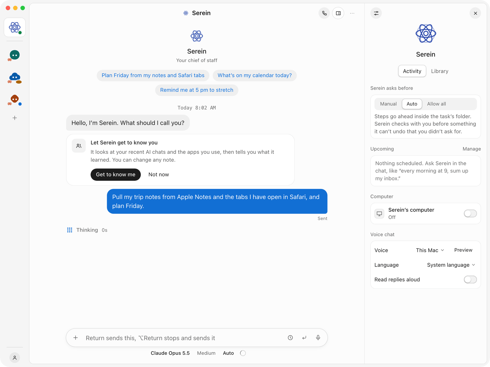

<p align="center">
  <picture>
    <source media="(prefers-color-scheme: dark)" srcset=".github/assets/serein-mark-dark.svg">
    
  </picture>
</p>

<h1 align="center">Meet Serein</h1>

<p align="center">The open source Grok Bot alternative, but it’s $0.</p>

<p align="center">
  <a href="LICENSE"></a>
  
  
</p>

<p align="center">
  <picture>
    <source media="(prefers-color-scheme: dark)" srcset=".github/assets/demo-dark.gif">
    
  </picture>
</p>

<p align="center"><b>Works with</b></p>

<p align="center">
  &nbsp;&nbsp;
  &nbsp;&nbsp;
  &nbsp;&nbsp;
  &nbsp;&nbsp;
  <picture><source media="(prefers-color-scheme: dark)" srcset=".github/assets/agents/opencode-dark.svg"></picture>&nbsp;&nbsp;
  <picture><source media="(prefers-color-scheme: dark)" srcset=".github/assets/agents/grok-dark.svg"></picture>&nbsp;&nbsp;
  <picture><source media="(prefers-color-scheme: dark)" srcset=".github/assets/agents/ollama-dark.svg"></picture>&nbsp;&nbsp;
  <picture><source media="(prefers-color-scheme: dark)" srcset=".github/assets/agents/lm-studio-dark.svg"></picture>&nbsp;&nbsp;
  <picture><source media="(prefers-color-scheme: dark)" srcset=".github/assets/agents/pi-dark.svg"></picture>
</p>

<p align="center"><sub>Claude Code · Codex · Cursor · Gemini CLI · OpenCode · Grok · Ollama · LM Studio · Pi</sub></p>

Serein is a personal assistant for your Mac. It runs the AI apps you already use, each signed in with its own account. It's free and needs no Serein account.

## Features

- **Ask in your own words.** Press <kbd>⌘E</kbd> and type. Pick the model and how much it thinks.
- **Use the AI plan you have.** Claude Code, Codex, Cursor Agent, OpenCode, Gemini CLI, Grok, Pi and Oh My Pi, or a local model through Ollama or LM Studio.
- **Three tasks at once.** Each task runs in its own process with its own permissions.
- **Undo any turn.** Serein snapshots each turn of a project in a private Git ref, so Undo puts the turn back.
- **You set what it asks about.** Choose Every step, Only risky steps or Allow all. Paying always stays with you.
- **Stays on your Mac.** History, projects and conversations are stored in your Library folder.
- **Plugins.** Add a skill or a tool. See the [plugin guide](docs/PLUGINS-GUIDE.md).

## Install

Download Serein for Mac from [serein.pro](https://serein.pro/#download). The build there is signed and notarized, runs on macOS 14 or later, and supports Apple Silicon and Intel.

Release builds update themselves from the newest [release](https://github.com/codejunkie99/Serein-Bot/releases). A build from source does not.

Or [build it from source](#build-from-source).

## Quick start

1. Open Serein. On **Connect an AI app**, pick an app and follow its sign-in, or choose **Set up later**.
2. On **Let Serein work in your apps**, grant the Mac access you want, or select **Open Serein** to skip it.
3. Ask **“Remind me at 5 pm to stretch.”** Or open a page and ask **“Summarize this page in three bullets.”**

More in [Getting started](docs/getting-started.md) and [Agents and models](docs/agents-and-models.md).

## Privacy and safety

- Your history, projects and conversations stay in `~/Library/Application Support/Serein/Library`.
- When you give a task to an agent, Serein passes the task and its context to that agent's app. The app sends them to its provider under your account, and that provider's charges apply.
- Clicking and typing on sites and acting in Mac apps are off until you turn them on.
- Turn snapshots stay in your repository under `refs/serein/turns/`. Serein never commits or pushes them.

Details in [Permissions and safety](docs/permissions-and-safety.md).

## Build from source

You need macOS 14 or later, the Xcode command-line tools, Swift and Python 3.

```sh
git clone https://github.com/codejunkie99/SereinBot.git
cd SereinBot
bash scripts/build.sh
python3 scripts/verify_package.py
open dist/Serein.app
```

The build writes `Serein.app` and a ZIP for your Mac's chip to `dist/`. See [Building from source](docs/building-from-source.md).

## Contributing

Issues and pull requests are welcome. Before you open a pull request, build the app and run `python3 scripts/verify_package.py`.


Agent names and logos belong to their owners and only show which tools Serein works with. Serein is not affiliated with or endorsed by them.
